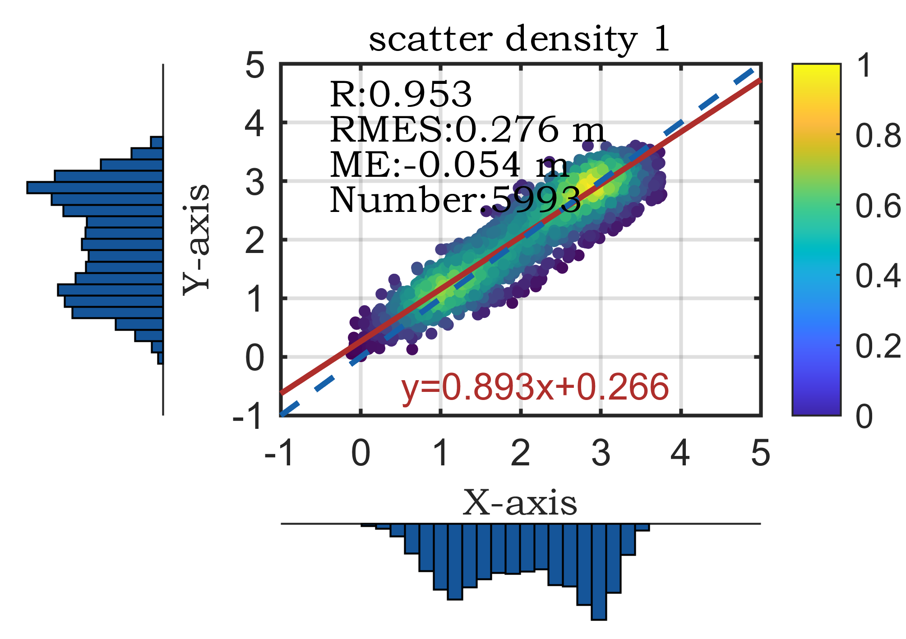
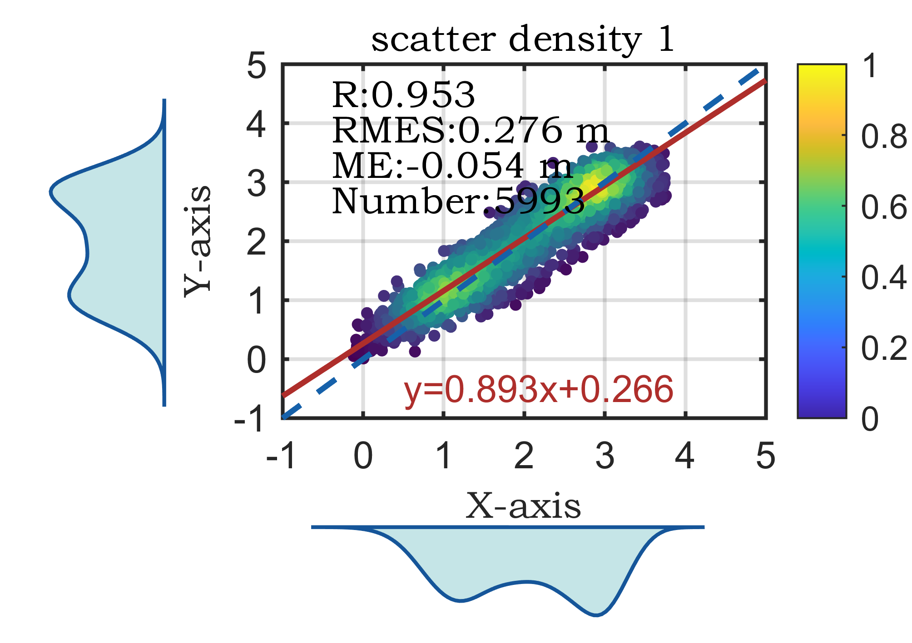

# MATLAB | 20th Research Plotting Issue: Scatter Density Dual Bar Chart

The tutorial for drawing and color data link can be found at the end of this document.
1. The appearance of the figure in an SCI paper is key to its acceptance.
2. In the figure, three sub-functions are involved as shown below:
\n        \n  
\n        \n  
Here's why figureWidth should be set to 8.5: this is because there is limited space for inserting figures when using a double column layout.
3. How is it calculated? A4 paper specifications: 210mm x 297mm. This size is defined by the International Organization for Standardization (ISO) 216, which is used worldwide.
4. The requirements for paper margins on a paper page are: top (T): 25 mm; bottom (B): 25 mm; left (L): 20 mm; right (R): 20 mm.
5. This means that the paper must be printed with A4 standard white paper, leaving ample blank edges around the sides for binding, copying, and annotation. Each side should have margins of 25mm on the top and bottom, and 20mm on the left and right. This is relative to most journal submissions.
6. Subtracting these margins from the total length gives us 170mm for a double-column layout, leaving only 85mm for single-column layout. This ensures that the font size remains unchanged when imported into Word. If the figure is 10cm wide, being reduced to 8.5cm after importing into Word, then the font size of the 10-point font will also be reduced, making it no longer the original 10-point font. This explains why some SCI papers have varying font sizes within each figure.

## Images

<!-- PAYMENT_BLOCK -->

## Get this dataset

- Payment link (Stripe): [Buy now](https://buy.stripe.com/3cs8yP7sY87d0vu9AB)
- Payment QR code: 

<!-- /PAYMENT_BLOCK -->
